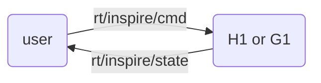

<div align="center">
  <h1 align="center">DFX Inspire Hand service</h1>
  <a href="https://www.unitree.com/" target="_blank">
    
  </a>
</div>

# 1. 📦 Introduction

[Unitree Robot RH56DFX Inspire Hand](https://support.unitree.com/home/en/H1_developer/Dexterous_hand) Controller.

<div align="center">
  
</div>


The user sends `unitree_go::msg::dds::MotorCmds_` messages to the `rt/inspire/cmd` topic to control the dexterous hand,
and receives `unitree_go::msg::dds::MotorStates_` messages from the `rt/inspire/state` topic to obtain its status.



The IDL data is an array containing joint-level values for all 12 motors of both hands.
Currently the dexterous hand only supports joint control, i.e. only the parameter `q` makes sense in the idl format. The others are reserved.


<div style="text-align: center;">
<table border="1">
  <tr>
    <td>Id</td>
    <td>0</td>
    <td>1</td>
    <td>2</td>
    <td>3</td>
    <td>4</td>
    <td>5</td>
    <td>6</td>
    <td>7</td>
    <td>8</td>
    <td>9</td>
    <td>10</td>
    <td>11</td>
  </tr>
  <tr>
    <td rowspan="2">Joint</td>
    <td colspan="6">Right Hand</td>
    <td colspan="6">Left Hand</td>
  </tr>
  <tr>
    <td>pinky</td>
    <td>ring</td>
    <td>middle</td>
    <td>index</td>
    <td>thumb-bend</td>
    <td>thumb-rotation</td>
    <td>pinky</td>
    <td>ring</td>
    <td>middle</td>
    <td>index</td>
    <td>thumb-bend</td>
    <td>thumb-rotation</td>
  </tr>
</table>
</div>


# 2. 🚀 Launch

## unitree h1
```bash
sudo apt install libboost-all-dev libspdlog-dev
# Build project
mkdir build & cd build
cmake ..
make -j6
# Terminal 1. Run h1 inspire hand service
sudo ./inspire_h1 -s /dev/ttyUSB0
# Terminal 2. Run example
./hand_example
```

## unitree g1

> This fork rewrites the G1 driver (`inspire_g1`); the H1 driver and the original headers are unchanged.
> See [G1 driver in this fork](#g1-driver-in-this-fork) below.

```bash
sudo apt install libboost-all-dev
# Build project
mkdir -p build && cd build
cmake ..
make -j6 inspire_g1
# Terminal 1. Run the G1 hand driver (sudo: the serial ports belong to the dialout group)
sudo ./inspire_g1 --network eth0
# Terminal 2. Your program publishes rt/inspire/cmd and reads rt/inspire/state.
# Note: ./hand_example opens and closes BOTH hands every second as soon as it starts.
```

# G1 driver in this fork

The upstream G1 driver stops delivering hand positions while it writes commands: on a G1 with one
RH56DFX hand, every position read failed from the first command until the driver's 1 s command
timeout after the last one, and the driver kept republishing the old position (failures only show
in `lost`). Upstream issue #6 reports the same with two hands. The serial layer waits a fixed 5 ms
per exchange, reads once, never flushes, and ignores write acknowledgements, so the cause can be
any late or partial reply. This driver removes that whole class of problems instead of tuning the
timing:

| Problem in the upstream G1 driver | This driver |
|---|---|
| Fixed 5 ms wait and a single `read()` per reply; no input flush; write acks ignored | Input flushed before each request; replies received as complete frames (header, length, checksum, ID, command and address checked) within a deadline; late or stray frames are skipped; write acks checked |
| FTDI adapter left at its 16 ms latency timer | Port opened in low-latency mode (latency timer 1 ms on `ftdi_sio`) |
| Both hands polled in one loop, a missing hand costs half of every cycle | One thread per hand; hands that do not answer at startup are skipped (`--hands auto`) |
| Ports hard-coded (`/dev/ttyUSB1` right, `/dev/ttyUSB2` left) | `--left-port`, `--right-port`, `--left-id`, `--right-id` |
| `q < 0` clamped to 0, which closes the finger | `q < 0` sends -1: the hand leaves that finger's target unchanged |
| Speed and force threshold never set (speed stays at its maximum) | `--speed`, `--force` at startup; per finger through `dq` and `tau` in the command |
| Force calibration writes register 1583 (inside FORCE_ACT) | `--calibrate-force` writes GESTURE_FORCE_CLB (1009), as in upstream PR #9 |
| State carries only `q`; a failed read republishes the old `q` | Force, current, temperature, status and error added; `reserve[1]` is the age of `q` |
| The target is rewritten every cycle while commands arrive | Written only when it changes (or after a failed write) |

### Messages

Unchanged layout: `rt/inspire/cmd` (`unitree_go::msg::dds_::MotorCmds_`) and `rt/inspire/state`
(`MotorStates_`), 12 entries, 0–5 right hand, 6–11 left hand; per hand pinky, ring, middle, index,
thumb bend, thumb rotation.

| Command field | Meaning |
|---|---|
| `q` | target in [0, 1], 1 = open, 0 = closed; `q < 0` leaves the finger's target unchanged |
| `dq` | optional speed in (0, 1] (× 1000 = SPEED_SET); 0 keeps the current speed |
| `tau` | optional force threshold in (0, 1] (× 1000 g = FORCE_SET); 0 keeps the current threshold |

A message with fewer than 12 entries or a non-finite value is rejected as a whole.

| State field | Meaning |
|---|---|
| `q` | measured angle in [0, 1] (ANGLE_ACT / 1000) |
| `lost` | cumulative failed position reads; it grows on every message for a hand that is not connected |
| `reserve[1]` | age of `q` in ms when the message was published (`UINT32_MAX` = never read) |
| `tau_est` | finger force [N] (FORCE_ACT) |
| `dq_raw` | actuator current [mA] (CURRENT) |
| `temperature` | actuator temperature [°C] |
| `mode` | motion status (STATUS: 0 releasing, 1 grasping, 2 position reached, 3 force reached, 5 current protection, 6 stalled, 7 fault) |
| `reserve[0]` | fault bits (ERROR: 1 stall, 2 overtemperature, 4 overcurrent, 8 motor fault, 16 communication) |

Force, current, temperature, status and error are read every `--status-every` loops (default 5).

### Options

```
--network IFACE        DDS interface (eth0 on the robot)
--namespace NAME       topic namespace, default inspire
--hands auto|left|right|both   auto skips hands that do not answer; the others require them
--left-port / --right-port     default /dev/ttyUSB2 / /dev/ttyUSB1 (Unitree's G1 wiring)
--left-id / --right-id         default 1 / 1
--rate HZ              loop rate per hand and state publish rate, default 100
--timeout-ms MS        deadline for one exchange, default 25
--speed N / --force N  set all fingers at startup (1..1000)
--clear-errors         clear the fault flags at startup
--calibrate-force      calibrate the force sensors and exit; the hands must be unloaded
```

The driver logs one line per hand every 5 s: loop rate, position reads and writes that succeeded
and failed, and the last failure type (timeout, bad frame, rejected, io error).

### Testing without hardware

`test/fake_rh56.py` (Python standard library only) serves the RH56 protocol on a pseudo-terminal
and moves its fingers toward the target. It can delay replies and acknowledgements, buffer output
like an FTDI latency timer, drop replies and inject garbage bytes:

```bash
python3 test/fake_rh56.py --seconds 60 --latency 16 --ack-delay 8 --drop 0.01 --garbage 0.02   # prints /dev/pts/N
./build/inspire_g1 --network lo --namespace inspire_test --left-port /dev/pts/N --right-port none
```

Use a separate `--namespace` so a driver running on the real hands never sees the test commands.

# FAQ
1. Error when `make -j6`
    ```bash
    ...
    /usr/bin/ld: inspire_ctrl.cpp:(.text._Z14serialize_intoIN10unitree_go3msg4dds_12MotorStates_EN3org7eclipse10cyclonedds4core3cdr14xcdr_v2_streamEEbPvmRKT_b[_Z14serialize_intoIN10unitree_go3msg4dds_12MotorStates_EN3org7eclipse10cyclonedds4core3cdr14xcdr_v2_streamEEbPvmRKT_b]+0x2be): undefined reference to `org::eclipse::cyclonedds::core::cdr::xcdr_v2_stream::finish_member(org::eclipse::cyclonedds::core::cdr::entity_properties&, bool)'
    /usr/bin/ld: inspire_ctrl.cpp:(.text._Z14serialize_intoIN10unitree_go3msg4dds_12MotorStates_EN3org7eclipse10cyclonedds4core3cdr14xcdr_v2_streamEEbPvmRKT_b[_Z14serialize_intoIN10unitree_go3msg4dds_12MotorStates_EN3org7eclipse10cyclonedds4core3cdr14xcdr_v2_streamEEbPvmRKT_b]+0x2d9): undefined reference to `org::eclipse::cyclonedds::core::cdr::xcdr_v2_stream::finish_struct(org::eclipse::cyclonedds::core::cdr::entity_properties&)'
    
    ```
    please compile and install `unitree_sdk2`:
    ```bash
    cd ~
    git clone https://github.com/unitreerobotics/unitree_sdk2
    cd unitree_sdk2
    mkdir build & cd build
    cmake ..
    sudo make install
    ```
2. Error when run `sudo ./inspire_h1 -s /dev/ttyUSB0` or `sudo ./inspire_g1`
    ```bash
    --- Unitree Robotics --- 
    Inspire Hand Controller  
    Open serial port /dev/ttyUSB* failed
    ```
    For **Unitree h1**, use the `-s` parameter to change the serial port name.  
    For **Unitree g1**, modify the serial port name directly in the source code.
